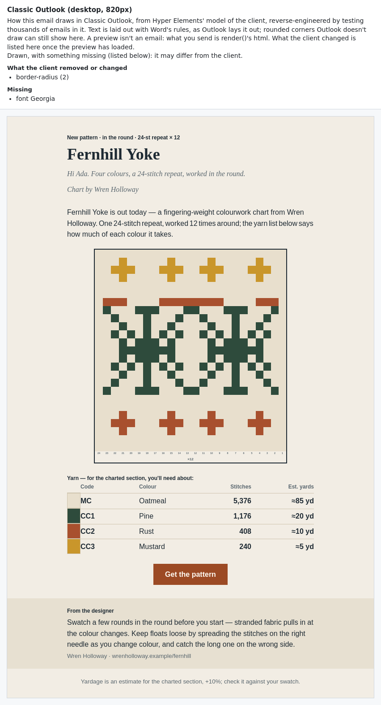
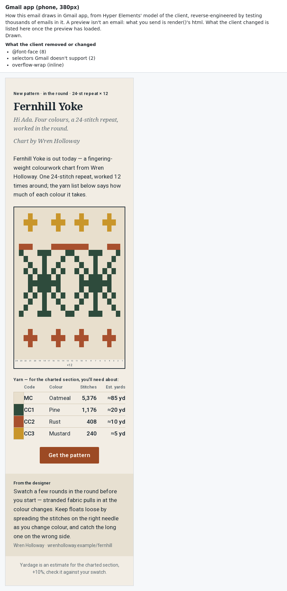
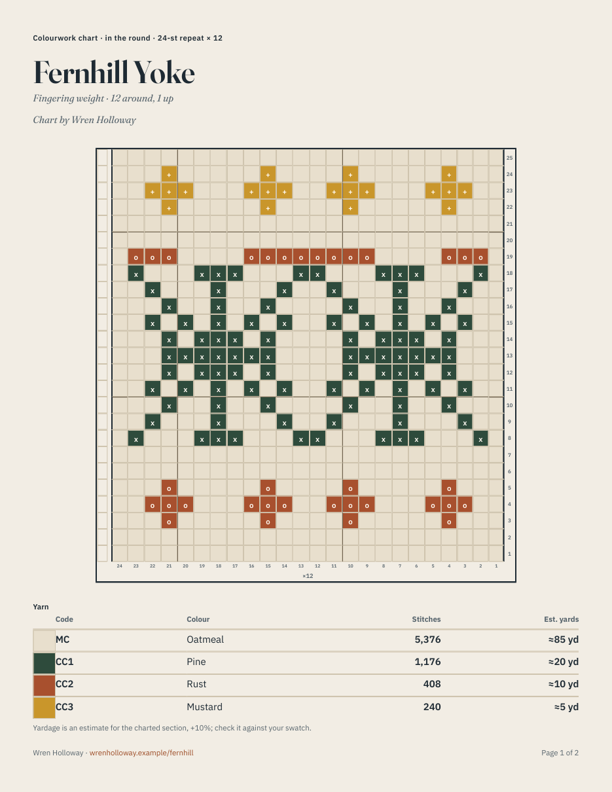
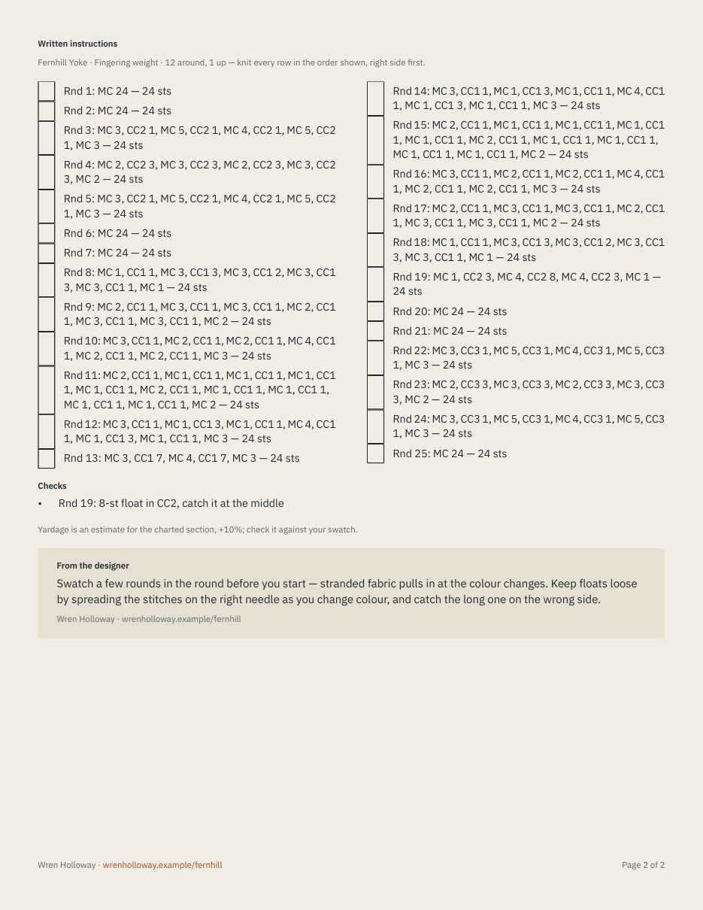
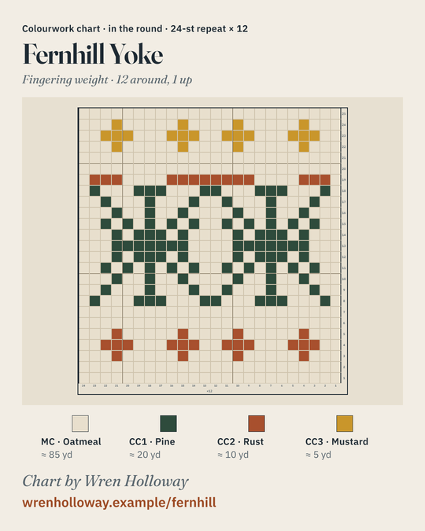

# Colourwork Kit

A stranded colourwork (Fair Isle) chart that reads the same in an inbox, on paper and on a phone. Write the chart once as a plain-text `.chart` file, and get:

- **An email** where the chart is real table cells in each yarn colour, with a "Get the pattern" button
- **A print PDF** (Letter, two pages): the chart with its colour key on page one, written row-by-row instructions with tick boxes and a checks list (long floats, rows over two colours) on page two
- **A share card** (1080 × 1350 PNG and SVG) for Instagram or Ravelry

All three are built with [Hyper Elements](https://hyperelements.dev) (`@hyper-elements/react`) and share one chart element. Stitch counts, yardage, written instructions and the checks are all derived from the chart, so the three outputs can't disagree.

| Email, classic Outlook | Email, Gmail app | PDF chart | PDF instructions | Share card |
|---|---|---|---|---|
|  |  |  |  |  |

The email screenshots come from Hyper Elements' email-client emulator (`@hyper-elements/email-clients`). The Outlook preview lists "Missing: font Georgia" because the emulator machine has no Georgia; real Outlook on Windows does.

## Why

A colourwork chart is a picture of the right side, and every tool wants its own copy: the designer charts it in software, the pattern PDF redraws it, the newsletter needs it as HTML, and the launch post wants a square image. The fiddly parts are the ones that differ by convention — stitch numbers run right to left along the bottom, row numbers sit on the right in the round but swap sides every row flat, wrong-side rows are read left to right, and yardage depends on the yarn weight and how many times the chart repeats. Get any of those wrong and three outputs disagree. Here they are derived once, from the chart itself.

## Write a chart

`charts/fernhill.chart` is the hero — a 24-stitch round yoke repeat worked 12 times around:

```
title: Fernhill Yoke
designer: Wren Holloway
mode: round            # round | flat (required)
weight: fingering      # lace | fingering | sport | dk | worsted | bulky (required)
repeats: 12 around, 1 up   # optional; "across" works for flat charts
repeat: 1-24           # optional column range, numbered from the right
url: https://wrenholloway.example/fernhill
note: one or two lines from the designer
key:
  . MC  Oatmeal  #e8dfcd
  x CC1 Pine     #2e4b3c
  o CC2 Rust     #a8502e
  + CC3 Mustard  #c9962b
chart:
  …rows as they look: the TOP line is the LAST row knitted, the bottom line is row 1…
```

From that file, `src/chart.ts` derives everything the outputs print:

- **Numbering** — stitch numbers 1, 2, 3… run right to left along the bottom; row numbers count up from the bottom row. In the round every row number sits on the right; flat, odd (right-side) rows number on the right and even (wrong-side) rows on the left.
- **Stitches per colour** — counted per chart, and multiplied by the `repeats` (around × up) for the charted section the yarn key reports.
- **Yardage** — stitches × yards-per-stitch for the weight × 1.10, rounded up to the nearest 5 yd, always labelled "estimate for the charted section, +10%; check it against your swatch".
- **Written instructions** — every row as `Rnd n:` or `Row n (RS|WS):` followed by its colour runs in knitting order (`MC 3, CC1 1, …`), ending in the stitch total.
- **Float check** — in any row with two or more colours, a single-colour run over 7 stitches is listed on page two ("Rnd 19: 8-st float in CC2, catch it at the middle"). In the round the row is treated as circular, so a run can wrap from one edge to the other.
- **Colour check** — stranded knitting keeps a row to two colours; a row carrying three or more gets a note beside the floats ("Rnd 5 carries 3 colours; stranded rows usually carry two"). A note, not an error — some designers strand three on purpose.

A mistake stops the build with one plain-English message naming the line: a missing or unknown `mode`/`weight`, a field set twice or an unknown field, a ragged row ("chart row 2 has 15 stitches; the first row has 16"), a chart character not in the key, a key entry the chart never uses, a duplicate symbol or code, a missing `MC` first entry, a bad hex, a malformed or out-of-bounds `repeat:`/`repeats:`, a non-http `url:`, or a chart over the 60 × 70 one-page limit ("Colourwork Kit prints up to 60 × 70 on one page; this chart is 61 wide").

`charts/sampler-flat.chart` is the flat proof: 16 × 12, two colours, worked flat. Its written instructions show the convention directly — `Row 2 (WS)` reads left to right (`MC 2, CC1 1, MC 13`) while `Row 3 (RS)` reads right to left (`MC 12, CC1 1, MC 3`), and its row numbers alternate sides down the chart.

## The look

A yarn shop's pattern leaflet, not a newspaper: undyed-wool paper (`#f2ede4`), a sueded band behind the chart (`#e7e0d1`), blue-black ink for type and chart lines (`#1e2a33`), hairline grid (`#cfc4ae`), and one rust (`#9c4a24`) for the one thing to do — the button and the link. The chart itself supplies the colour. Fraunces, a soft old-style serif, sets the titles and the designer's note; IBM Plex Sans sets the numbers, labels and instructions. Contrast on the paper: ink 12.6:1, muted 5.1:1, rust 5.3:1 (5.9:1 under the white button text).

## How Hyper Elements is used

| Feature | Where | What it does here |
|---|---|---|
| `defineTheme` + `Register` | `src/theme.ts` | One typed theme: every `token()` and `apply` name is checked by `tsc` |
| `formats` | `src/theme.ts` | Body, row and heading sizes per root (email, canvas), so no root restyles by hand |
| Named styles | `src/theme.ts` | `label`, `number`, `muted`, `standfirst`, `designer`, `caption`, shared by all three outputs |
| `Heading` levels | `src/theme.ts` | Level 1 is the serif title (smaller on phones in email); level 2 is the small sans section heading: Yarn, Written instructions, Checks |
| `defineElement` | `src/elements.tsx` | Three custom elements with typed, validated props, shared by every output: `ColourChart` (rows, key, mode, cell size, repeat range, symbols, tracker, merged runs), `YarnKey` (swatch, code, name, stitches, yards) and `Masthead` (kicker, title, standfirst, greeting merge tag, fit-to-one-line title) |
| Shared chart | `src/elements.tsx` | `ColourChart` is `Table`, `TableRow` and `TableCell`, one cell per stitch in its yarn colour: sized to the page in the PDF and card, 18px merged in the email; row numbers on the correct side, stitch numbers along the bottom, a heavier line every ten and around the repeat |
| Run merging | `src/elements.tsx` | `merged` draws same-colour neighbours as one `colSpan` cell with no internal gridlines — the email's 600 stitch cells become ~115, holding the file at 87 KB; `rowNumbers={false}` drops the row-number column for the same reason (the PDF keeps it) |
| `symbols` + contrast pick | `src/elements.tsx` | Prints each non-MC cell's key character in ink or reversed, chosen by the yarn's luminance, so the PDF still reads printed in black and white |
| `MergeTag` | `src/elements.tsx`, `src/email.tsx` | The masthead's `greetingMergeTag` writes "Hi {{first_name}}." for the sending service to fill, ahead of a standfirst sentence derived from the chart ("Four colours, a 24-stitch repeat, worked in the round.") |
| Scoped `tokens` | `src/email.tsx`, `src/pdf.tsx` | The designer's note band swaps the background token instead of restyling its children |
| `Email` + `Button` hover | `src/email.tsx` | 600px email: masthead, centred chart, yarn key, one rust button; phone styles for narrow screens |
| `render` + `emailClients()` | `scripts/render-email.tsx` | Renders once and checks the email against 11 clients |
| `renderInEmailClients` | `scripts/render-email.tsx --preview` | Previews the design itself (with `mergeTag` filling the name) in classic Outlook, the Gmail app and Apple Mail, light and dark where the client has a dark mode |
| `Document` + `PageBreak` + `PageFooter` + `PageNumber` + `Link` + `renderPdf` | `src/pdf.tsx`, `scripts/render-pdf.tsx` | Two Letter pages with "Page 1 of 2" and the pattern URL as a link in the footer; the print HTML loads the same web fonts |
| `Canvas` + `fit` | `src/card.tsx` | The title and footer lines shrink to fit instead of wrapping; the chart sits on a wool band with the yarns beneath |
| `layoutImage` + `renderImage`, `strict` | `scripts/render-card.tsx` | Measures the card first; a missing glyph or anything past the canvas fails the build |

### What the client checks found

No errors or warnings. The notes, all cosmetic: no web font loads in Outlook, Gmail, Yahoo or AOL, so those clients show Georgia and Arial; classic Outlook draws the button square-cornered and skips its hover and the small-caps letter spacing on the labels; the Gmail app on other phones keeps desktop sizes (the layout still stacks). The chart needs nothing removed in any client: the cells are plain table cells with background colours, and the merged runs still line up because the numbering row holds one cell per stitch.

## Run it

Requires Node 20 or later.

```bash
git clone https://github.com/cipoklean/colourwork-kit.git
cd colourwork-kit
npm install

npm run render          # PDF, email and card for charts/fernhill.chart into out/
npm run preview:email   # also writes email-client previews to out/email/previews/
```

Every render script takes an optional chart path (default `charts/fernhill.chart`):

```bash
npx tsx scripts/render-pdf.tsx charts/sampler-flat.chart
```

| Command | Writes |
|---|---|
| `npm run render:email` | `out/email/fernhill.email.html` and `.txt` (89,440 bytes — under Gmail's 102 KB clip) |
| `npm run preview:email` | The above, plus one HTML preview per client in `out/email/previews/` (not committed; run this to make them). Open them in Chrome or Chromium |
| `npm run render:pdf` | `out/fernhill.pdf`, `out/fernhill.print.html` |
| `npm run render:card` | `out/fernhill-card.png`, `out/fernhill-card.svg` |

## Project layout

```
src/
  types.ts      ParsedChart, ChartColour, FloatNote, ColourNote
  chart.ts      the .chart parser and every derivation
  theme.ts      the shared, typed theme
  fonts.ts      web fonts for the email and print HTML
  elements.tsx  ColourChart, YarnKey and Masthead, shared by all three outputs
  email.tsx     Email root
  pdf.tsx       Document root
  card.tsx      Canvas root
scripts/        one render script per output, plus the shared chart loader and font loader
charts/         fernhill.chart (the hero) and sampler-flat.chart (the flat proof)
fonts/          Fraunces and IBM Plex Sans static TTFs (SIL OFL 1.1)
out/            rendered outputs, committed so you can look without installing
docs/           README screenshots
```

## Licence

Code: MIT. Fonts: Fraunces and IBM Plex Sans, SIL Open Font License 1.1 (see `fonts/OFL.txt`). The designer, the pattern and its URL are made up.
